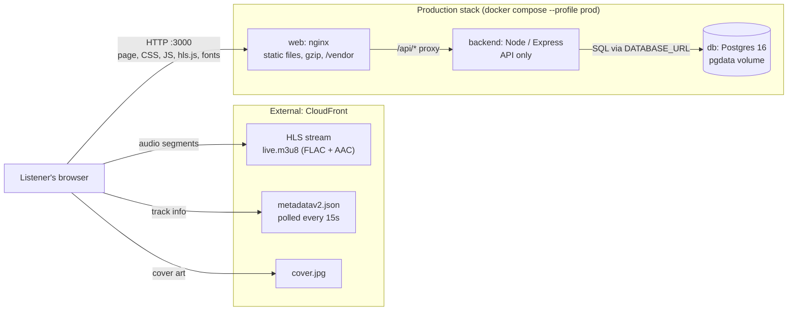
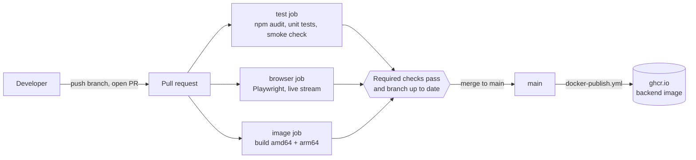

# Architecture

This page shows how Radio Calico runs in production and how changes reach `main`. The diagrams are Mermaid, which GitHub renders directly.

## Runtime system (production)

The browser loads the page from nginx and audio, metadata and cover art from CloudFront. The backend is reachable only through nginx, and Postgres only from the backend.

## Delivery pipeline (GitHub)

The three checks named `test`, `browser` and `image` are required on `main`. The publish step pushes only the backend image. nginx is built from `Dockerfile.nginx` by compose and isn't published.

## Development stack

The dev profile (`docker compose --profile dev`) runs the app under nodemon with the source mounted, and a second Postgres (`db-dev`). It is served on port 3001 and isn't part of the production diagram above.
